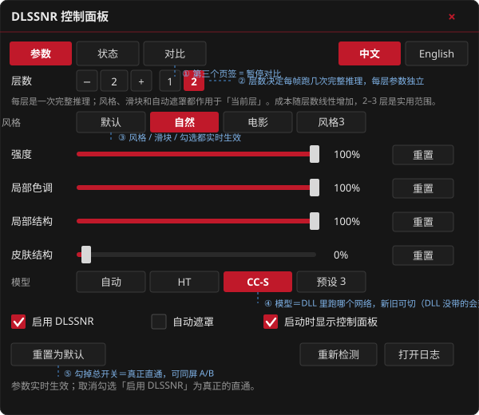
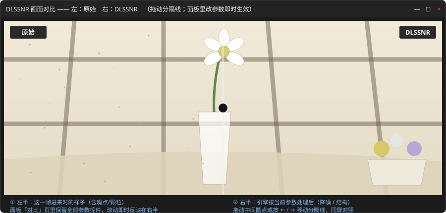

# dlssnr-filter

**一个 DirectShow 滤镜，把 NVIDIA 的神经渲染网络（DLSS "NR"）接进任意播放器，边看边调参数。**

在 PotPlayer / MPC-BE / MPC-HC 里挂上它，播放的视频会逐帧经过神经降噪 / 去块 / 细节重建；
配一个实时控制面板，能在播放中用滑块调强度、局部色调、局部结构、皮肤结构和自动遮罩，**改完立刻生效，不用重启播放器**。

- 🚀 **全程 GPU** —— `NV12 → 计算着色器 → 神经推理 → 计算着色器 → NV12`，CPU 只搬两次平面，不做色彩转换
- 🎚️ **实时调参** —— 共享内存通道，播放中拖动滑块即时生效
- 🔍 **状态可见** —— 面板显示心跳、帧计数、每帧耗时，以及"为什么现在没在处理"的人话原因
- 🧯 **绝不破坏播放** —— 引擎缺失 / 初始化失败 / 尺寸不支持 / 输入不是 NV12，一律**降级为直通**
- ⏱️ **跟不上就丢帧，而不是把画面拖慢** —— 引擎耗时超过帧间隔时（4K60、1440p120），丢掉已经来不及显示的帧，
  画面**保持在时钟上**（4K60 约 29 fps），而不是越播越晚、和声音越差越远；引擎跟得上时**一帧不丢**。面板与托盘可关
- 🔽 **或者反过来：用画质换帧率** —— 面板里可开「降分辨率处理」并用滑块选 25–100%（4K60 建议 ≤50%），
  神经部分跑在更小画面上再放大，帧率就回来了；画面会软、降噪会变弱，**默认关**，开之前先看对比页
- 📦 **自包含** —— 引擎就在这个 DLL 里，不需要外部宿主；运行期只依赖 NVIDIA 的 `nvngx_dlssnr.dll`

---

## 需要什么

```
app\dlssnr_dshow.dll          ← 本仓库编译产物（滤镜 + 自带 GPU 引擎 + 托盘图标 + 控制面板）
app\dlssnr_dshow.ini.template ← 配置模板（可复制成 dlssnr_dshow.ini 手动改）
app\nvngx_dlssnr.dll          ← ★ 需要自行准备
app\nvngxruntime.dll          ← ★ 随它一起取得
```

`nvngx_dlssnr.dll` 是 NVIDIA 的 DLSS「NR」网络，**没有官方公开下载渠道**，本项目开发所用是社区构建版。
**本仓库不含、也不得再分发任何 NVIDIA 二进制** —— 详见 [`docs/THIRD_PARTY.md`](docs/THIRD_PARTY.md)。

**引擎已内置**，不需要外部宿主，也不需要 [dlssnr-toolkit](https://github.com/CyanKe/dlssnr-toolkit)
（那个仓库现在只服务于它自己的 Python 应用）。缺少上面那两个 DLL 时滤镜照常工作（逐帧直通），日志会说明原因。

---

## 安装

**1. 编译** —— 需要 Visual Studio 2022（C++ 工作负载）＋ **NVIDIA NGX SDK**：

```
deps\sdk_include\   nvsdk_ngx.h 等头文件
deps\sdk_lib\       nvsdk_ngx_s.lib
```

`deps/` 不进仓库（NVIDIA 的东西不可再分发）。这是**编译期**依赖 —— 编出来的 DLL 运行时不加载 SDK 的任何文件。

```
tools\build.bat        →  app\dlssnr_dshow.dll
```

**2. 放运行库** —— 把 `nvngx_dlssnr.dll` 和 `nvngxruntime.dll` 放进 `app\`（与 `dlssnr_dshow.dll` 同级）。

**3. 注册（需管理员）** —— `tools\register_filter.bat`；反注册加 `/u`。

**4. 挂进播放器** —— MPC-BE：`选项 → 扩展滤镜 → 添加滤镜`，选 `app\dlssnr_dshow.dll`，设为**首选**；
PotPlayer：`滤镜 → 滤镜管理器 → 添加外部滤镜`，选同一个 DLL，设为**强制使用**。

> 滤镜注册为 `MERIT_DO_NOT_USE`，**不会被任何播放器自动插入** —— 这是故意的，
> 否则它会劫持机器上所有 DirectShow 图。

播放器要输出 **NV12**（LAV Video Decoder 默认就是），渲染器用 **EVR**。
接口上仍接受 NV12 / RGB24 / RGB32，但**引擎只处理 NV12**：RGB 输入原样直通，面板会显示原因。

---

## 使用

界面是**通知区域（托盘）里的一个小图标**，实现在滤镜 DLL 内部 —— 不需要 Python，也不多开进程。
播放时图标自动出现，停止播放自动消失。

| 操作 | 效果 |
| --- | --- |
| **右键图标** | 启用 / 风格 / 强度 / 局部色调 / 局部结构 / 皮肤结构 / 自动遮罩 / 丢帧保同步 / 打开控制面板 / 打开日志 / 关于 / 隐藏图标 |
| **双击图标** | 打开控制面板（深色紧凑界面，带滑块，可连续调参，实时生效） |
| **播放器内** | 滤镜 → DLSSNR → 属性，打开同一个控制面板 |

控制面板有三个页签：`参数` / `状态` / `对比`，右上角可切换 `中文` / `English`。

- **参数页** —— 一行一个参数（名称 / 滑块 / 百分比读数 / 各自的重置按钮），底部是开关与 `重置为默认` / `重新检测` / `打开日志`
- **状态页** —— 引擎状态、PID、帧统计、视频与引擎会话尺寸
- **对比页** —— 打开一个**独立窗口**：同一帧左＝原始、右＝处理后的样子，中间一条**可拖动的分隔线**（同 NVIDIA ICAT 的分屏思路）。
  这一页**保留全部参数控件**，拖滑块右半会**实时重算** —— 不用切页签就能对着同一帧调参。
  关闭窗口后，滤镜一帧都不再复制、也不再重算（零开销）。





面板是**单实例**的（关掉只是隐藏，从托盘能找回同一个窗口）、**暂停不会让它消失**、参数**实时生效**并写回本机
`dlssnr_dshow.ini`、界面**随 DPI 缩放**。跳转和拖进度条也不会卡住播放器。
为什么"暂停对比"要另开一个窗口而不是让播放器画面动 —— 见 [`docs/ENGINEERING_NOTES.md`](docs/ENGINEERING_NOTES.md)。

### 参数

配置文件两个：`app\dlssnr_dshow.ini.template`（**模板**，随仓库分发，永远保持文档默认值）和
`app\dlssnr_dshow.ini`（**运行时配置**，面板写回这里，**不进仓库**；不存在时用内置默认值）。

| 键 | 说明 |
| --- | --- |
| `enabled` | 总开关。0 = 真正的直通（逐字节等于输入） |
| `style` | 风格 0-3 |
| `intensity` | 强度 0-100（%），默认 100 = 1.0 |
| `localtone` / `localstruct` | 局部色调 / 局部结构 0-200（%），默认 100 = 1.0 |
| `skinstructure` | 皮肤结构 0-200（%），默认 0 = 关。**要配合 `automask=1` 才有作用** |
| `automask` | 自动遮罩 0/1，默认 0 |
| `dropframes` | 引擎跟不上时**丢帧保同步**，默认 1。0 = 每帧都处理并交付（画面会越来越落后于声音） |
| `maxlagms` | 丢帧策略容忍的额外滞后上限（ms）。0 = 自动（一次引擎耗时 + 一个帧间隔）；调大 = 少丢几帧、多留一点滞后 |
| `procenable` | **降分辨率处理**开关，默认 0（关）。1 = 神经部分跑在更小的画面上再放大，用画质换帧率 |
| `procscale` | 降分辨率处理的处理分辨率（%）25–100，默认 50。开关关着时也记住这个值 |
| `autoshow` | 开始播放时是否自动打开控制面板 |

四个强度都是**引擎自己单位**的百分比（`100% = 1.0`）。滑块范围按参数分别定，依据是实测：
`intensity` 在 1.0 以上是**死区**（1.0 与 2.0 逐字节相同），所以只给 0-100%；
`localtone` / `localstruct` 到 2.0 都还有效，给到 200%。实测数据见
[`docs/ENGINEERING_NOTES.md`](docs/ENGINEERING_NOTES.md)。

---

## 性能

实测（RTX 5070 Ti Laptop，驱动 616.56）：**真实片源 + MPC-BE + LAV**，数字取自滤镜自己发布的遥测
（播放时跑 `python tools\read_telemetry.py`，看到的就是面板状态页那一组数）：

| 片源 | 每帧预算 | 引擎耗时 | 实测 |
| --- | --- | --- | --- |
| 1920×1080 **60p** | 16.7 ms | 9.6 ms | **59.9 fps**（满帧） |
| 3840×2076 **24p**（4K 蓝光） | 41.7 ms | 34.7 ms | **24.0 fps**（满帧） |

**引擎跟不上的时候（丢帧策略）**

4K60 要 34.7 ms，预算只有 16.7 ms —— 一秒 60 帧里有一半是"无论怎么排都来不及显示"的。
旧行为是把每一帧都处理完再交付，于是视频分支只能以 ~29 fps 推进，而音频按参考时钟走 60：
**每播 1 秒就落后约 1 秒**，几秒之后音画就完全对不上了（看起来像慢放）。

`dropframes=1`（默认）改成：处理之前先用参考时钟判断这一帧还能不能按时显示，来不及的**直接丢掉**。
被丢的帧不花引擎时间，留下来的帧时间戳原样不动，所以渲染器仍在正确的时刻显示它们 —— 滞后不再累积，
稳定在"一次引擎耗时"的量级（4K60 约 35 ms —— 这个固定偏差补不回来，但也不会再继续恶化）。
丢帧量正好等于超出的负载：**输出帧率 = `1000 / 每帧耗时`**。

**建议上限**（`dropframes=1`）

- **720p – 1080p60** —— 满帧有余量（1080p60 引擎 9.6 ms + 两次平面拷贝 ≈ 11 ms，预算 16.7 ms），**一帧不丢**
- **1440p60** —— 引擎 17.7 ms 越过预算，稳定在 **~56 fps**（丢 ~6%，滞后有界）
- **1440p120** —— 稳定在 **~56 fps**（丢掉约一半；120 → 56 在运动上仍然比 60p 源更顺）
- **4K24 / 4K30** —— **满帧**（34.7 ms / 41.7 ms 预算）
- **4K60** —— **~29 fps**（丢约一半），画面比原来"跳"，但**音画不再漂移**；想要更平滑只能降低引擎成本（分辨率/参数）

数字来自两条途径：满帧那两行是真实播放实测，超载那几行是
`tools\drop_policy_sim.py` 对策略本身的离线仿真（它同时跑 `dropframes=0` 做对照：
4K60 的滞后逐帧线性增长，4K24/1080p60 则一帧不丢）。

**另一条路：降分辨率处理（面板里的独立开关 + 25–100% 滑块）。** 神经部分跑在更小的画面上、
再把结果放大回原尺寸（进出的帧始终是原分辨率，只有网络那一段缩小）。4K 实测（两次运行，
这台笔记本的功耗状态本身会让同一档差 30%）：`100% = 31.9 / 42.1 ms`（原生）→
`75% = 19.9 / 26.9 ms`（两次都超预算）→ `50% = 11.1 / 18.9 ms` → `25% = 7.0 / 10.2 ms`。
**所以 4K60 要开到 25–50%，具体看当时的 GPU 状态** —— 面板状态页有实时的 ms/帧可以对着调。
1080p 上同一条曲线是 10.6 / 7.1 / 5.0 / 4.1 ms（原生的 60p 本来就跟得上，没必要开）。

代价是真的，而且**不只是变软**：降采样发生在进网络之前，等于先把噪声抹掉，**降噪随之停摆** ——
把局部色调/结构关掉、只留降噪时，输出与"纯缩放、不跑网络"只差 0.51 灰阶，
而原生路径同样设置下是 6.7（剩下那点变化基本都来自局部色调/结构这两个邻域算子）。
而且网络不再按它被训练的方式工作：25–100 每一档都量过，**不同档位的观感不是单调变化的**，
所以**别照着数字挑，用面板的对比页对着自己的片源挑**。
它**默认关** —— 这是一条把决定权交给用户的取舍。
数据和机制（含 25–100 每一档的测量）见 [`docs/ENGINEERING_NOTES.md`](docs/ENGINEERING_NOTES.md) 第 8 节。
如果只是想要 4K60 满帧，更干净的路子是让**播放器/解码器**输出 1080p ——
网络在真实 1080p 上工作正常（9.6 ms，真的在降噪）。

外推用稳态拟合 `T(ms) ≈ 2.9 + 3.83 × 像素数(MPix)`（引擎本身：720p 6.0 / 1080p 10.7 / 1920×1440 13.8 /
2560×1440 17.7 / 3840×2160 34.4 ms）。每档要先让 GPU 升到稳态再测 —— 短促负载会把时钟压在 1.3 GHz，
同一分辨率两种状态能差 1.5 倍；开自动遮罩只多 0.0–0.1 ms，画面内容基本不影响开销。
完整方法、独立复测，以及**像素级自检**（`tools\engine_selftest.cpp`：断言引擎确实改变画面、改参数确实生效）见 [`docs/ENGINEERING_NOTES.md`](docs/ENGINEERING_NOTES.md)。

**为什么够快**：旧路径要在 CPU 上把整帧来回翻译
（`NV12 → BGR24 → RGBA8 → 推理 → RGBA8 → BGR24 → NV12`），3840×2076 下那四趟色彩转换要 **48 ms/帧**，
**比神经网络本身还贵**（那段循环的写入带宽只有 0.82 GB/s —— 卡在指令上，没被向量化）。
换到内置 GPU 引擎之后，4K24 从 12.9 fps 变成 24.0 fps、1080p60 从 42.9 变成 59.9。
着色器用的是与旧路径**逐位一致**的 BT.709 有限范围整数运算，**画面没有变化**。

---

## 实现说明

`dlssnr_dshow.cpp` 完全自包含：Windows SDK 有 `strmbase.lib` 但**没有 `streams.h`**，也没有 ATL，
所以 `CTransformFilter` 系列用不了 —— 滤镜直接实现 `IPin` / `IMemInputPin` / `IBaseFilter`，
只复用系统自带的 `CLSID_MemoryAllocator`。引擎（`dlssnr_engine.cpp`）自带 D3D12 + NGX，不依赖外部宿主。

踩过的坑都记在源码注释里：**注册必须设 `REG_PINFLAG_B_OUTPUT`**（否则滤镜没有输出引脚，而 `GraphBuilder`
不读这个标志 —— 手工搭图测试全绿、真播放器却全败）、**输出引脚不能缓存媒体类型**、**必须自建 MemoryAllocator**
（EVR 的分配器在 commit 前 `cbBuffer` 读作 0）、**绝不要伪造分辨率**。
引擎的生命周期约束（NGX 每进程只能初始化一次、`nvngx_dlssnr.dll` 必须常驻）写在 `src\dlssnr_engine.h` 顶部。

---

## 授权

自有代码采用 **MIT**（见 [`LICENSE`](LICENSE)）。
本仓库**不包含、也不得再分发**任何 NVIDIA 软件，详见 [`docs/THIRD_PARTY.md`](docs/THIRD_PARTY.md)。

DLSS、RTX Video 是 NVIDIA Corporation 的商标与技术。本项目与 NVIDIA 无隶属关系，亦未获其背书。
